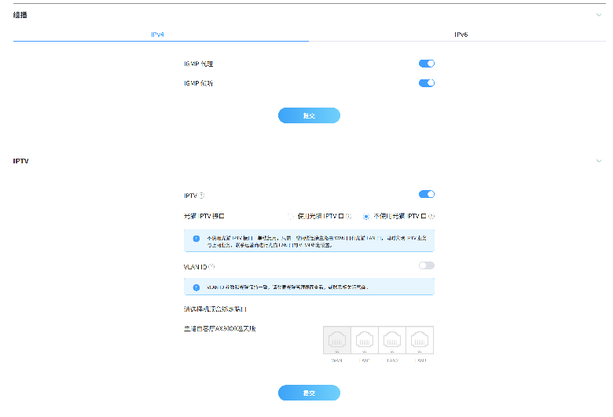
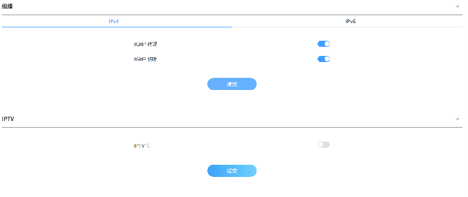

# 在中兴巡天路由器上开启北京联通 IPTV 组播

前面几篇文章分别介绍了在 OpenWrt 上用 [udpxy](https://mp.weixin.qq.com/s/2BK9NeseH6v-BfGyUl9bGQ)、[igmpproxy](./blog-operator-iptv-igmpproxy.md) 和 [rtp2httpd](./blog-operator-iptv-rtp2httpd.md) 转发宽带运营商 IPTV 的方法。这些方案都要求路由器能刷 OpenWrt，并且需要手动装包、改配置。如果你用的是中兴巡天这类原厂固件的路由器，其实不用折腾那么多：它自带了 IGMP 代理功能，点几下开关就能看运营商 IPTV。

## 一、网络环境

先说明一下我的环境，方便你对照：

- 宽带：北京联通；
- 光猫上**没有**专门的 IPTV 口，所有 LAN 口都是普通上网口；
- 接线方式：光猫任意一个 LAN 口，直接接到中兴巡天路由器的 WAN 口即可，不需要额外跳线。

也就是说，运营商的组播流就在普通的宽带线路上，路由器只要能把 IGMP 加入请求转发到 WAN 侧，内网设备就能收到组播流。

## 二、开启 IGMP 代理和 IGMP 监听

登录路由器后台，打开 **应用** 菜单，往下找到并展开 **组播** 选项，在 **IPv4** 标签页下有两个开关：

- **IGMP 代理**：把内网设备发出的 IGMP 加入 / 离开请求代理到 WAN 口，这是看组播 IPTV 的关键；
- **IGMP 监听**：也就是 IGMP Snooping，让路由器只把组播流转发到真正订阅了的端口，避免组播流量泛洪到所有设备。

把这两个开关都打开，然后点击 **提交** 即可。



就这么简单，没有其他需要配置的地方。之后内网里的电脑、机顶盒用支持 UDP/RTP 组播的播放器，直接播放 [iptv-sources2](https://iptv-sources2.pages.dev/) 提供的北京联通组播源就行：

```text
https://iptv-sources2.pages.dev/q_bj_iptv_unicom_m.m3u
```

## 三、IPTV 选项卡开不开都行

在 **组播** 的下方还有一个 **IPTV** 选项卡，里面有一个 IPTV 总开关，打开后会出现「光猫 IPTV 接口」「VLAN ID」以及指定路由器哪个 LAN 口作为 IPTV 口等设置。

我实测的结论是：**这个开关打开还是关闭，对播放没有影响，两种状态下都能正常播放**。

下面这张图是把 IPTV 开关关掉之后的状态，组播里的两个开关仍然保持打开：



原因不难理解：这个 IPTV 选项卡是给「光猫有专用 IPTV 口、需要透传 VLAN 到指定 LAN 口」的场景准备的，适合接运营商机顶盒。而我这边的组播流本来就走普通宽带线路，不需要 VLAN 透传，真正起作用的只有上面组播里的 **IGMP 代理** 和 **IGMP 监听**。

如果你的光猫有专用 IPTV 口，而且希望用运营商机顶盒，那可以再按需打开这个选项卡里的设置；只是想用电脑、盒子播放 m3u 的话，忽略它就好。


